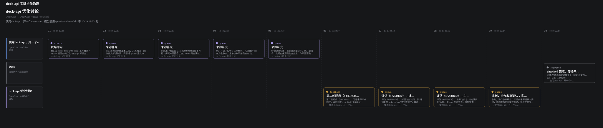

# deck-api 协作实例

这一页记录 deck-api 在真实项目里的用法与教训。例子整理自 traceroute 仓库
2026-10-18 至 2026-10-20 的多 Agent 协作记录，主机、路径、别名和账号均已脱敏。

- Deck 内打开 **工具 → 协作泳道**，或直接访问 `/deck-api`，可交互查看四个场景的步骤、命令和注意事项。
- 数据源在 `shared/deck-api-swimlanes.json`；下面的静态图由 `npm run swimlane` 生成。
- 单条命令的完整语义见 [deck-api.md](deck-api.md)。



## 1. 委派实现并回传（默认 send 模式）

主会话先冻结文件范围、验收命令和产物路径，再把自包含问题交给独立执行会话。
子会话看不到来源历史，所以背景必须写进问题本身。

```bash
DA="${CODEX_DECK_HOME:-$HOME/.codex-deck}/bin/deck-api"

bash "$DA" create codex --name '实现模块' --file ./task.md
# 回执给出询问别名与目标会话别名，例如 7f3a2c90 / @s-3f9kq2pz
```

执行会话改代码、跑单测和 smoke，然后主动回传：

```bash
bash "$DA" send --session codex:<thread> --file ./result.txt
```

来源收到的是普通队列消息：空闲时立即送达，运行中排队等空闲，不会注入用户正在看的回合。
需要追加约束时，用回执里的询问别名：

```bash
bash "$DA" send --to @7f3a2c90 -- '补充：并发上限按 8 处理'
```

要记住：

- 202 只表示持久受理，不代表目标已开始执行或已读。
- 默认 send 模式不会自动转发最终答复；目标不主动 `send`，来源就收不到结论。
- 回报要带可复核的文件、命令和结果，不能只写“已完成”。

## 2. steer 受理 ≠ 送达

执行会话在长回合里跑任务时，主会话常用 `steer` 下发修订：
`queue` 会在长回合里滞留，`interrupt` 会杀掉在途工作，而 `steer` 追加到当前回合，
不打断已做的工作。

```bash
bash "$DA" send --to @7f3a2c90 --mode steer --request-id rev1-002 -- \
  '只改评估器，冻结数据校准口径'
```

真实记录里出现过“回执成功但目标从未收到”：投递瞬间目标回合恰好切换，
旧实现静默丢掉这条 steer。来源只看到 202 和 messageId，几天后才发现没有新代码。

正确做法：

1. 发出关键裁定后，在约定时限内核对落地证据：新代码 diff、新 run 目录、GPU 占用，三选一有实据。
2. 没有证据就用**同一个** `--request-id` 重发同一条消息；内容和 mode 必须一致。
3. 不同消息必须换新的 `request-id`。
4. 不要用 `interrupt` 代替重发：它会杀掉目标正在进行的回合，还可能让投递失败。

`steer` 只支持 Codex 这类可转向的会话；其他目标用 `queue`，或在明确接受损失时用
`interrupt`。

## 3. 监督远端长任务（wake）

远端任务先用 tmux / nohup / sbatch 独立运行，确认加载完成、计算已开始，再挂
watcher 并把回合交还给用户。

```bash
bash "$DA" wake poll -l train-r3 -i 300 -- \
  ssh gpu-a 'sacct -j 4821 -n -X -o State | head -1'
```

- 一个任务一个 watcher；`watch` 适合真正阻塞到结束的命令，同步查询用 `poll`。
- 连续 10 次连接失败、状态进入结束态或输出为空（`GONE`）都会触发通知。
- 收到唤醒后先核实进程、退出码、日志尾部和产物，再继续；`GONE` 不等于完成。
- 不要直接 `kill` watcher，用 `wake stop <pid>`，否则 Deck 会记为失联。
- 重启 Deck 后如果 token 轮换，旧 watcher 可能无法投递；需要跨重启保持时固定 token 或重新挂载。

## 4. detached 独立执行（只查不推）

`create --detached` 让来源继续做自己的事，子会话在最终答复里交付：

```bash
bash "$DA" create codex --detached -- \
  '独立完成模块；最终答复列出改动、产物、验证命令和未决问题'
```

完成、失败、中断都不向来源推送消息。来源在合适时机主动查询：

```bash
bash "$DA" tasks
bash "$DA" result @7f3a2c90
bash "$DA" inspect @7f3a2c90 --tail 30
```

- `result` 返回 `item`、`result`、`pending`；`result` 里有 `turnId/text/completedAt/truncated`。
- `pending=true` 表示回合已完成但原生历史尚未同步，稍后再查，不要重建会话。
- 追问会开启新回合，旧交付会被清除，避免旧答复冒充新结果。
- 来源可能正在跑用户回合，自动返回会打断或污染它，所以 detached 不推送 `[done:]`。

## 维护这张图

```bash
npm run swimlane                          # 全部场景 → docs/deck-api-swimlane.svg
npm run swimlane -- --scenario steer     # 只导出一个场景
node scripts/deck-api-swimlane.mjs --input shared/deck-api-swimlanes.json --output /tmp/lanes.svg
```

- 新增场景直接改 `shared/deck-api-swimlanes.json`；页面、静态 SVG 和本页说明共用这一份数据。
- 泳道图的 `kind` 支持 `message`、`send`、`queue`、`run`、`success`、`failure`、`wake`、`query`。
- 不要在示例里写真实主机、账号、密钥或个人路径；用 `gpu-a`、`acme-eval`、`/srv/acme/...` 这类占位名。
